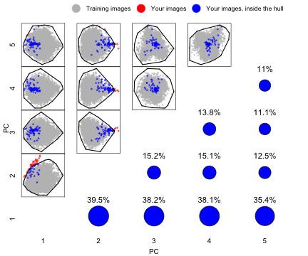

---
output:
  github_document:
    html_preview: false
---

<!-- README.md is generated from README.Rmd. Please edit that file -->

# AutoCDAScorer 

<!-- badges: start -->

[](https://github.com/joshuandwilliams/AutoCDAScorer/actions/workflows/R-CMD-check.yaml)
[](https://app.codecov.io/gh/joshuandwilliams/AutoCDAScorer)
[](https://lifecycle.r-lib.org/articles/stages.html#experimental)

[](https://keras.io/)

<!-- badges: end -->

AutoCDAScorer scores cell death areas (CDAs) in UV agroinfiltration images of
*Nicotiana benthamiana* leaves. It gives each CDA a cell death severity score
from 0 (no cell death) to 6 (strong cell death). Scoring by eye is slow and
varies between raters. AutoCDAScorer's best model agrees with the consensus
score about as often as human raters do.

Its diagnostic plots show whether your CDA images resemble the images the
models were trained on. Models are only reliable on images like their training
data, so check these plots before trusting the scores.



## Installation

AutoCDAScorer needs R 4.1.0 or later. Install it from GitHub with `pak`:

```{r, eval = FALSE}
install.packages("pak")
pak::pak("joshuandwilliams/AutoCDAScorer")
```

`pak` also installs EBImage, which comes from Bioconductor rather than CRAN.

The `"ordinal"` model and the diagnostic plots work straight away. The
`"geom_cnn"` and `"ensemble"` models use 16 convolutional neural networks
(CNNs), which run in Python through Keras 3.15.0 or later. They need two
one-off steps. First set up Python and Keras:

```{r, eval = FALSE}
AutoCDAScorer::check_and_install_tensorflow()
```

If you already have a suitable Python environment, point R at it with
`reticulate::use_condaenv()` instead. Then download the CNNs, about 4.7 MB,
from [Hugging Face](https://huggingface.co/joshuandwilliams/AutoCDAScorer):

```{r, eval = FALSE}
AutoCDAScorer::download_models()
```

## Models

Each model was tested on the same 308 CDA images, which no model saw during
training or selection. On those images, human raters agree with the consensus
score 68.92% of the time, and to within one score 92.80% of the time.

| Model | Description | Exact | Within one score |
|----|----|----|----|
| `"ensemble"` | The 16 CNNs below averaged together, then averaged with the ordinal regression model. The most accurate option. | 68.83% | 98.38% |
| `"geom_cnn"` | The single best CNN, trained on geometrically augmented CDA images. | 66.88% | 99.03% |
| `"ordinal"` | Ordinal regression on 12 hand-crafted colour, brightness and shape features. No neural network. | 63.31% | 96.43% |

`"ensemble"` and `"geom_cnn"` were trained on the same images, so they share a
diagnostic plot. `"ordinal"` was trained on a smaller set of real CDA images
only, so it has its own.

## Using AutoCDAScorer

```{r, eval = FALSE}
library(AutoCDAScorer)

# Load cropped CDA images from a folder
cdas <- load_images("path/to/cropped/cdas")

# Or crop them from source images, using bounding boxes from CDALabeller.
# Run this from the folder that holds the source images.
cdas <- crop_and_load_images("bounding_boxes.csv")

# Check that the images resemble the training images
diagnostic_pca("ensemble", cdas, num_pcs = 5, plot_type = "convexhull")

# Score them. "ensemble" and "geom_cnn" need the downloaded CNNs; "ordinal" does not.
predict_score("ensemble", cdas)
```

To record bounding boxes around CDAs in source images, use
[CDALabeller](https://github.com/joshuandwilliams/CDALabeller).

## Guide

The [guide](https://github.com/joshuandwilliams/AutoCDAScorer/blob/main/vignettes/AutoCDAScorer.Rmd)
works through each step with example images and explains how to read the
diagnostic plots.

## Citing AutoCDAScorer

```{r, eval = FALSE}
citation("AutoCDAScorer")
```
